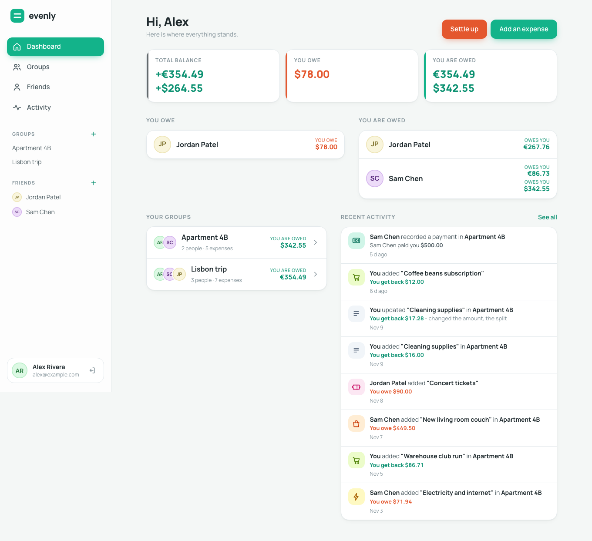
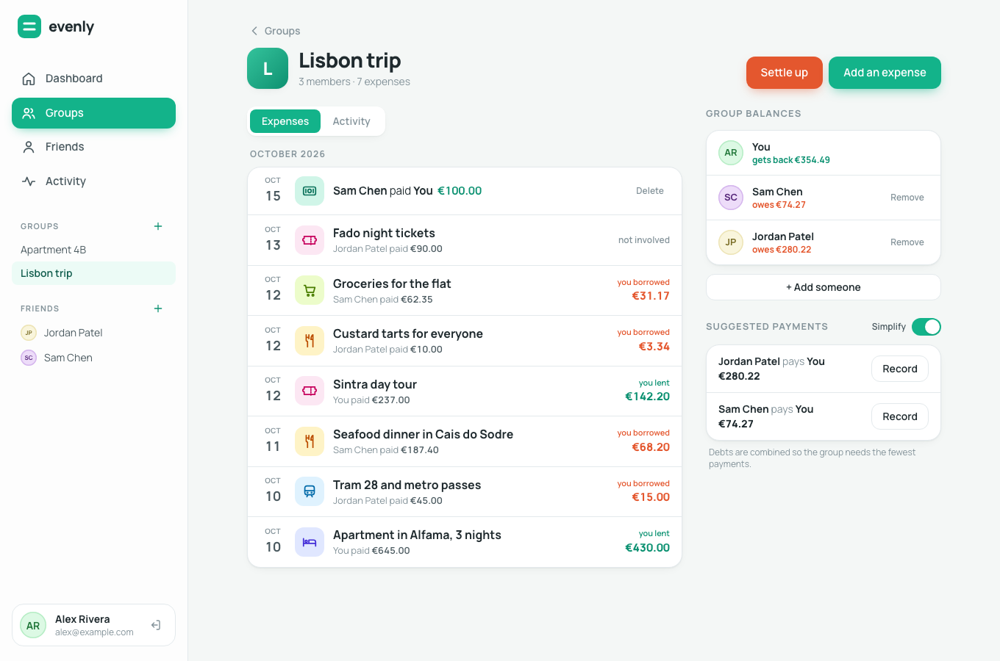
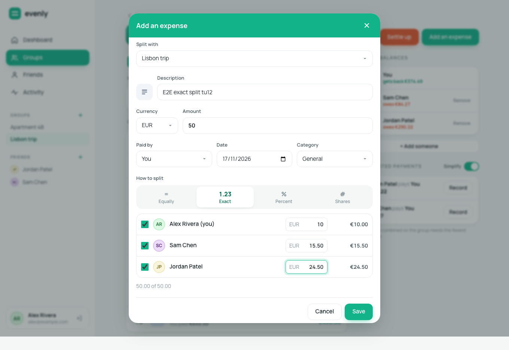
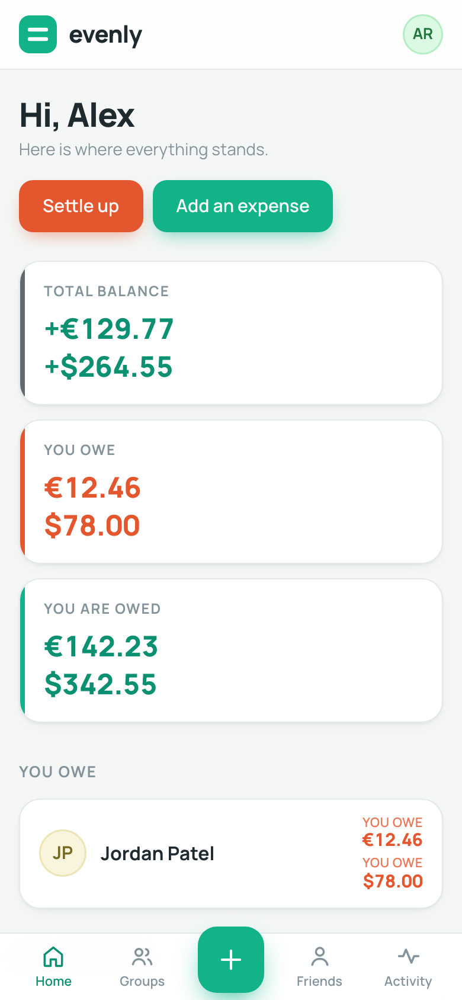

# Evenly

An expense-splitting web app for friends, flatmates and trips: groups, friends, four split modes,
exact balances, debt simplification and settle-up payments.

> **Educational clone.** Evenly is an original project built to study the UX patterns of
> Splitwise. It is not affiliated with, endorsed by, or connected to Splitwise, Inc. No Splitwise
> logos, illustrations, copy or source code are used. The name, logo, palette and all code here
> are original.



## Quick start

```bash
npm install
npm run dev        # API on http://127.0.0.1:3001, web on http://localhost:5173
```

Open http://localhost:5173 and click **Use the demo account**, or log in with:

| Name | Email | Password |
|---|---|---|
| Alex Rivera (main demo) | `alex@example.com` | `evenly-demo` |
| Sam Chen | `sam@example.com` | `evenly-demo` |
| Jordan Patel | `jordan@example.com` | `evenly-demo` |

The database (`server/data/evenly.db`) is created and seeded on first start. Reset it any time
with `npm run seed` (with the dev server stopped).

| Script | What it does |
|---|---|
| `npm run dev` | API (tsx watch) + Vite dev server, side by side |
| `npm run build` | Type-checks both packages, bundles the API (esbuild) and the client (Vite) |
| `npm test` | Vitest: server (domain math + API integration) and client (form logic + components) |
| `npm start` | Runs the built API, which also serves `client/dist` on port 3001 |
| `npm run seed` | Deletes and re-seeds the SQLite database |
| `npm run e2e` | Playwright walkthrough against running dev servers; writes `docs/screenshots/` |

Note: if your shell exports `NODE_ENV=production`, npm skips devDependencies. The repo's
`.npmrc` sets `include=dev` so `npm install` always installs the build and test tools.

## Stack

- TypeScript (strict) everywhere, TypeScript 7.
- **Client**: React 19, React Router, Vite 8, Tailwind CSS 4, hand-built components,
  Manrope (self-hosted through `@fontsource-variable`).
- **Server**: Express 5, SQLite via `better-sqlite3`, `zod` 4 validation, Node `scrypt`.
- **Tests**: Vitest + Supertest + Testing Library; Playwright for the browser walkthrough.

## Architecture

```
shared/src/         pure domain code, imported by both sides
  money.ts          integer-cent parsing/formatting, currencies
  splits.ts         equal / exact / percent / shares -> exact cent shares
  balances.ts       net balances, pairwise debts, simplify-debts
  categories.ts
server/src/
  db.ts             schema (users, sessions, friendships, groups, expenses, shares, settlements, activities)
  auth.ts           scrypt hashing, sessions, CSRF header check, rate limiter
  schemas.ts        zod request schemas
  store/            data access (users, ledger, activity)
  services/         business rules (expenses, groups, read models for pages)
  routes.ts, app.ts REST API
  seed.ts           demo data
client/src/
  lib/              fetch wrapper + query hook, auth context, formatting
  components/       layout (sidebar + bottom nav), ledger list, activity feed, UI primitives
  features/         expense form (+ pure draft logic), settle-up / friend / group forms
  pages/            login, dashboard, groups, group detail, friends, friend detail, activity
```

The split and balance logic lives in `shared/` so the expense form previews exactly what the
server will store, and the server re-validates every request with the same code.

### Money and balance rules

- **Money is integer cents end to end**: the database, the API, and the client. User input is
  parsed from strings into cents (`parseCents`) without floating point.
- **Percentages are basis points** (33.33% = 3333). Shares are whole numbers.
- **Rounding**: uneven splits use the largest-remainder method. Leftover cents go to the
  participants with the largest fractional remainder; ties go to the earlier person in the list.
  For equal splits that means the first people listed get the extra cent (10.00 / 3 = 3.34, 3.33, 3.33).
- **Validation**: exact amounts must sum to the total, percentages must sum to 100%, shares must
  be positive. The server rejects anything else with a 400 and a readable message.
- **Balances** are per currency and never converted. An expense credits the payer with the
  total and debits each participant their share; a payment from A to B credits A and debits B.
  Every group's balances sum to zero (tested).
- **Simplify debts** (per-group toggle, on by default): greedy matching of the largest debtor
  with the largest creditor, giving at most n-1 payments per currency. With it off, the group
  shows direct pairwise debts.
- Friend balances and the dashboard use pairwise debts across all groups and non-group expenses.

### API

All routes are under `/api`; mutating requests need the header `X-Requested-With: evenly`.

| Method | Path | Purpose |
|---|---|---|
| POST | `/auth/register`, `/auth/login`, `/auth/logout` | account and session |
| GET | `/auth/me` | current user or `null` |
| GET | `/dashboard` | totals, per-person balances, groups, recent activity |
| GET, POST | `/friends` | list with balances, add by name + email |
| GET | `/friends/:id` | shared expenses, payments, balance, shared groups |
| GET, POST | `/groups` | list, create (with members) |
| GET, PATCH | `/groups/:id` | detail with balances and suggestions; rename / simplify toggle |
| POST, DELETE | `/groups/:id/members[/:userId]` | add member, remove member (only when settled) |
| POST, GET, PUT, DELETE | `/expenses[/:id]` | expense CRUD |
| POST, DELETE | `/settlements[/:id]` | record or delete a payment |
| GET | `/activity?limit=&groupId=` | activity feed |

### Security notes

- Passwords: `scrypt` (N=16384, r=8, p=1, 16-byte salt), compared with `timingSafeEqual`.
  Unknown emails still run a hash so timing does not reveal which emails exist.
- Sessions: random 256-bit token in an `HttpOnly`, `SameSite=Lax` cookie; only its SHA-256 is stored.
- CSRF: SameSite cookie plus a required custom header on every state-changing request.
- Login and registration are rate limited per IP (20 per minute).
- Group data is visible only to members (non-members get 404). Non-group expenses are visible
  only to the people in them.

## Decisions made without asking

- **Name and look**: the clone is called "Evenly" with its own logo, a mint/coral palette and
  Manrope, informed by (not copied from) the observed design language.
- **Invited friends**: adding a friend or group member by an email with no account creates an
  "invited" person who cannot log in. Registering with that email later claims the record.
  This is fine for a local demo but would need email verification in production.
- **Joining a group befriends everyone in it**, so group members can also split outside the group.
- **Currencies**: 8 supported, no conversion. All currencies use two decimal places, including JPY
  and VND, for simplicity.
- **Removing a member** is blocked while they have a non-zero balance in that group.
- **Expenses cannot move between groups** when edited.
- **Settle up from the dashboard or a friend page** records a non-group payment, which settles the
  overall friend balance; settling from a group records it in that group.
- **Out of scope** (paid tier in the reference product, or beyond the brief): receipt scanning,
  charts, currency conversion, recurring expenses, comments, email notifications.

## Tested flows

Automated, all passing:

- `npm test`: **54 tests**. Server: split math (including 2,000 randomized allocations that must
  sum exactly), balance/simplify invariants, and API integration (auth, CSRF, validation,
  authorization, CRUD, settle-up, member removal rules, activity). Client: expense-form draft
  logic for all four modes, the API client (including cache refresh after 204 deletes), and
  money components.
- `npm run e2e`: **29 browser checks** with Playwright against the dev servers: login (disabled
  button, wrong password, demo login), dashboard, group view, adding an expense with each split
  mode, blocking an unbalanced split, expense detail, edit, delete, simplify toggle, settle up
  from a suggestion, add friend, friend balance, activity feed, create group with a member,
  remove member, logout, mobile bottom navigation and add-expense sheet, and zero console or
  HTTP errors.

Screenshots from the last run are in [`docs/screenshots/`](docs/screenshots/).

| Group view | Add expense (exact) | Mobile |
|---|---|---|
|  |  |  |

## Research

How the reference site was observed (public pages only, with REA browser tooling), what was seen
vs inferred, and the derived feature checklist: [`docs/rea-findings.md`](docs/rea-findings.md).
